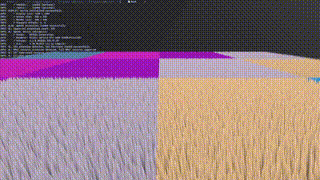

# Graphical Sandbox

 This is a repo that will contain all my future graphical programming endeavours currently only host a primitive grass rendering pipeline.
 
# Grass Rendering


# Future Additions planned

 Other large particle system like swarms of bats, fireflies, and maybe even fluid sims.

 Dynamic skyboxes, maybe even a realistic sun position.

 Lighting

 Clouds

# Building
  Building this project is as simple as running CMake which on linux is trival to set up and on windows a pain in the behind.
  But I digress. Below are the provided build scripts that should work on a good amount of systems.

 ```
 ```
   cmake -S . -B build
   cmake --build build
   ./graphical_sandbox
 

  Please note that this was not tested on any other system then a Linux Mint Distro so the likely hood of this working
  on a separate Operating system while greater then non-zero could also still be zero.
  
  Make sure the machine that you run this on supports Opengl 4.3 or higher and has a compatible C standard library 
  (Yes, I know. Quite the demanding requirements.)


